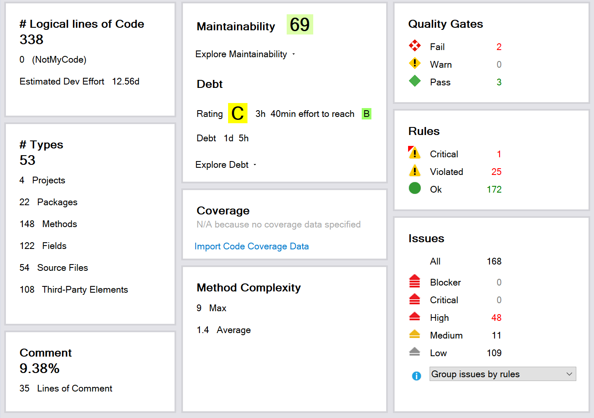
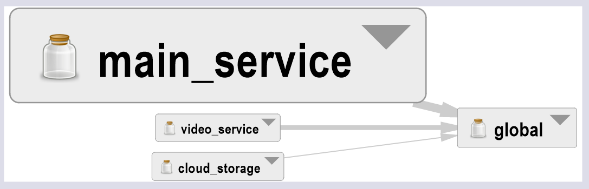
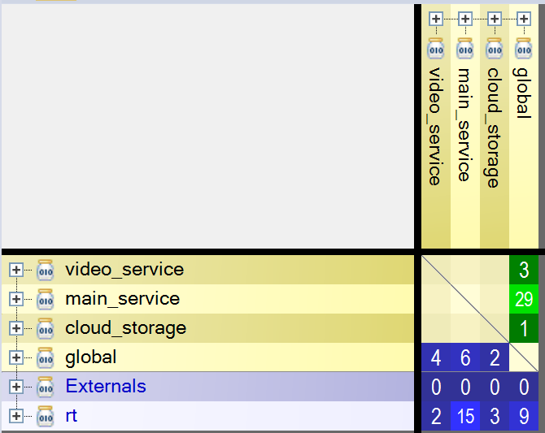
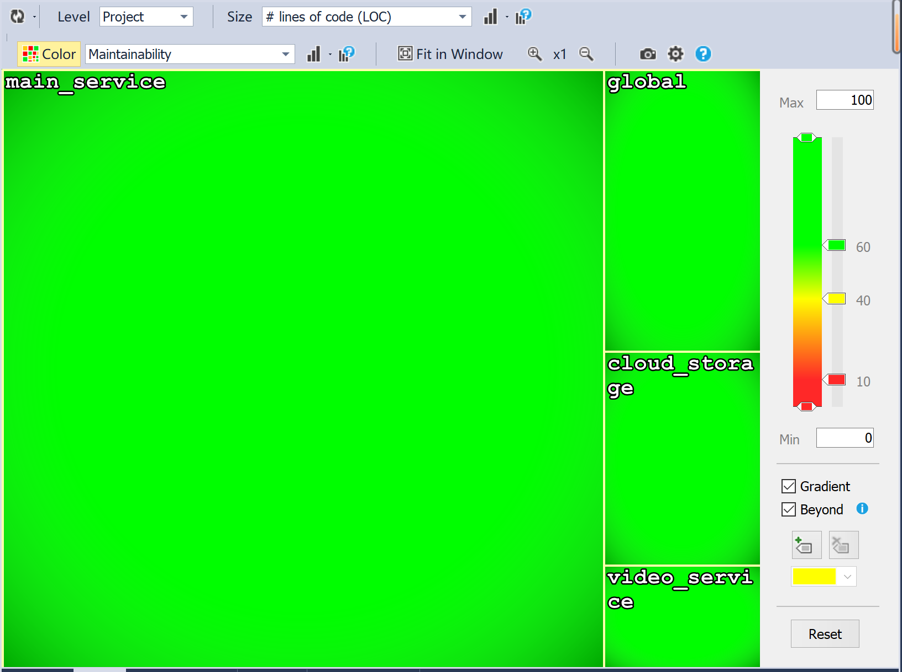
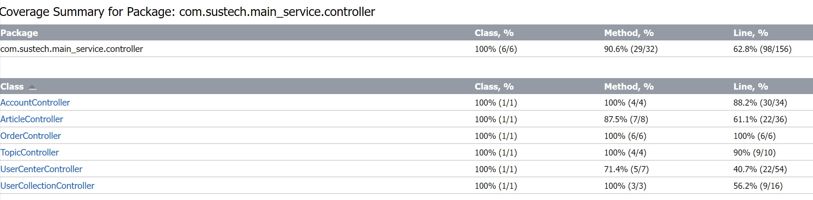
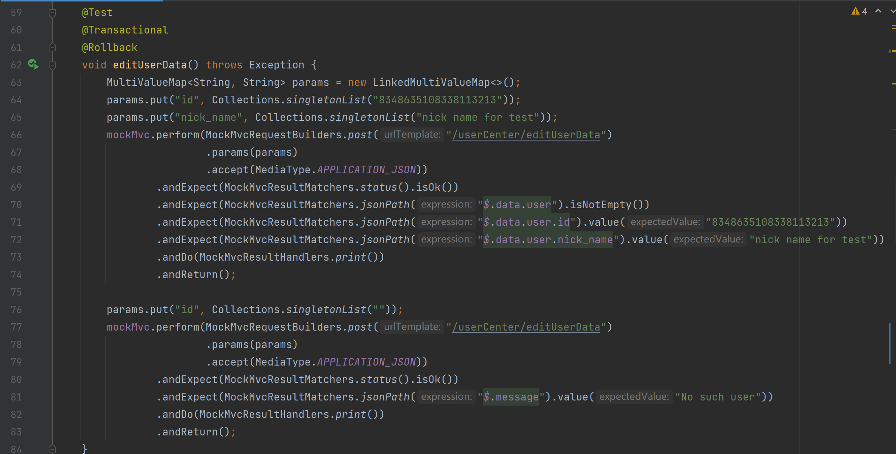
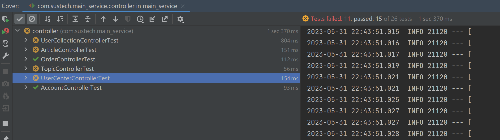

## Metrics
### 各项指标
* Lines of Code: 338
* Number of modules/subprojects: 4
* Number of packages: 22
* Number of source files: 54
* Number of 3rd party dependencies: 108

### 可维护性

我们项目一共有四个模块，其中 global 模块被其他三个模块所依赖。但是从 dependency matrix 我们可以看到，除了 global 模块，其他模块均不会相互依赖，这保证了其他三个模块的可扩展性。

从热力图可以看出，我们项目的可维护性还是比较高的

## Tests
### 测试介绍
我们对后端进行了 IT 和 E2E 测试。在IT（集成测试）中，我们使用了 springboot 自带的 springboot test 功能以及 IDEA 自带的 coverage report 生成功能对后端代码进行了测试。首先我们对每个 controller 的各个方法都编写了自动化测试方法，在运行测试并生成报告后可以看到，我们测试的总行数覆盖率达到了62.8%。

在 E2E 测试中，我们同时运行前端和后端，以普通用户的身份尝试各种提供的功能，并且结果能比较好地符合预期。

### 部分测试源码及链接

// 需要加上链接

### 测试结果
覆盖率报告

测试结果

